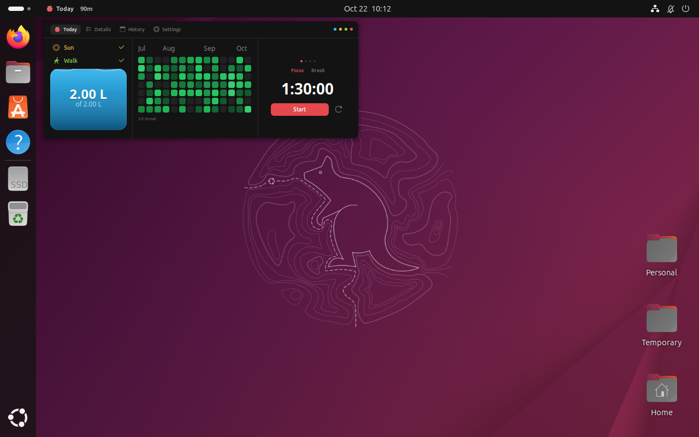
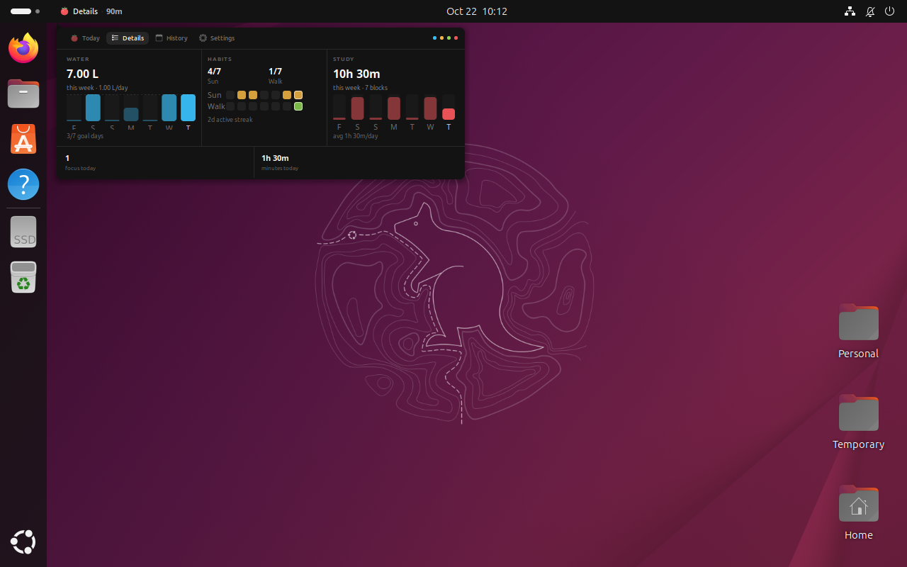
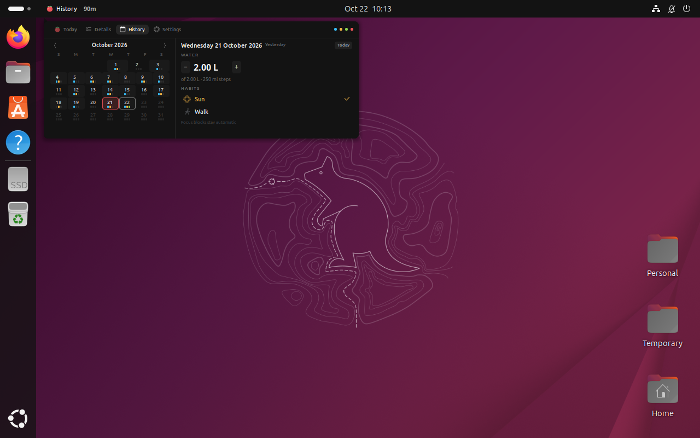
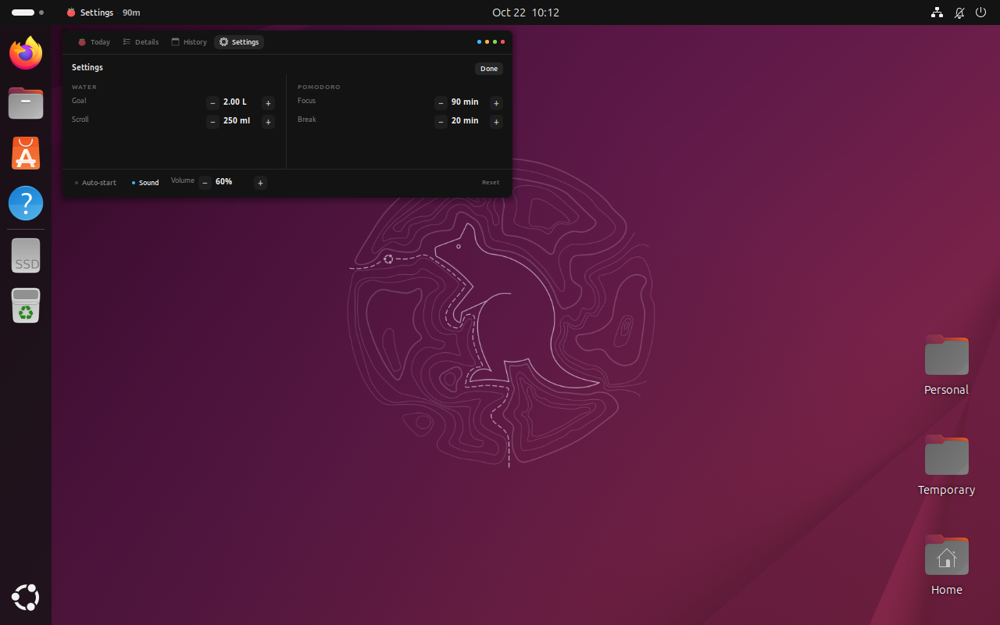

<h1 align="center">🍅 Study Tracker</h1>

<br>

<h3 align="center">A GNOME Shell extension that keeps a study routine in the top bar.<br>Sunlight, walks, water, focus blocks, weekly details, a history calendar and a Pomodoro clock</h3>

<p align="center">
  
  <a href="https://github.com/Petri-Hub/gnome-study-tracker/releases/latest"></a>
  <a href="LICENSE.md"></a>
  <a href="https://github.com/Petri-Hub/gnome-study-tracker/commits/main"></a>
</p>

<br>

## About

> **TL;DR:** Study Tracker puts the things I check during a study day in one small GNOME Shell popup. The top bar shows the tomato, the current tab and the timer. The popup has a Today dashboard, a Details view with weekly graphs, a History calendar for correcting past days, and settings, plus sunlight, a walk check, water, a 14-week heatmap and a 90/20 Pomodoro clock. Everything stays on the machine in a JSON file.

<p align="center">
  
</p>

## Why it exists

I wanted one place for the timer, the water I drank, the days I studied and whether I went outside for a walk. A browser tab for each of those felt like too much, and the panel is always in sight. The extension is a personal tool, so it stays small and local. It has no account and makes no network requests.

## What it does

### The panel

The panel item sits on the left side of the top bar, after the Activities button and before any media controls. It keeps the tomato logo, then shows the name of the active tab and the timer, so the current screen and the remaining time are visible without opening the popup.

| State | Timer |
| --- | --- |
| Idle | `90m` or `20m`, muted |
| Focus running | `1:29:55`, red |
| Break running | `19:55`, green |
| Paused | remaining time, dimmed |

### Popup

Click the panel item to open the dashboard. It is a single dark surface with thin rules between sections, matching the top bar instead of adding another window.

The header has four tabs: **Today**, **Details**, **History** and **Settings**. The Today tab uses the tomato, while Details, History and Settings have their own icons. Switching tabs slides and fades the content, and the page height stays fixed so the popup does not jump. The active tab stays selected when the popup is closed and reopened.

#### Today

The first tab is the dashboard: sunlight, walk and water on the left, the 14-week heatmap in the middle and the Pomodoro clock on the right.

##### Sun, walk and water

Click the Sun row to switch today's sunlight on or off. The Walk row works the same way and records whether you went for a walk. The blue tank is the water control. Scroll over it to log one step, 250 ml by default, and scroll the other way to correct a mistake. The level eases to the new amount, and a short hint appears only while the pointer is over the tank.

##### Heatmap

The middle pane shows the last 14 weeks. Each cell is a day on a green scale: partial water and partial focus already move it away from the empty colour, and the brightest green means the full water goal, sunlight, a walk and two focus blocks. Hover a cell for its numbers, scroll or drag sideways to walk back through older weeks, and double-click to return to today.

##### Pomodoro

Focus is 90 minutes by default and the break is 20. The Focus and Break buttons switch the timer you are looking at. A running focus block keeps going while the break view is open, and starting a break pauses focus instead of resetting it. A focus block is logged only when the countdown reaches zero. Pausing or resetting before that gives no partial credit. The four dots above the tabs show progress through the current set of four focus blocks.

When a phase reaches zero, the popup switches to the next one, sends a notification and plays a chime. Auto-start is off by default; turn it on in settings to start the next phase immediately.

#### Details

The Details tab looks at the last seven days. Water has a bar chart with the daily goal as a dashed line. Habits shows sunlight and walks as two rows of daily squares, with the current streak underneath. Study shows the focus minutes for each day and the total number of focus blocks. The row at the bottom keeps today's focus count and minutes, separated from the charts by a thin rule.

<p align="center">
  
</p>

#### History

The History tab is for correcting a day that was under-recorded. It opens on yesterday and shows one month at a time; each day has tiny water, sun and walk dots so you can spot the day you want. Click a day, then use the `−` and `+` buttons to change its water in the configured step, or toggle Sun and Walk. The Today button jumps back to today, and the arrows move one month at a time, up to a year back. Focus blocks stay automatic.

<p align="center">
  
</p>

#### Settings

The Settings tab opens the water goal, water scroll step, focus and break lengths, auto-start, sound and volume. Reset returns every setting to its default; it does not delete the day history.

<p align="center">
  
</p>

### Where the data lives

```text
~/.local/share/gnome-study-tracker/state.json
```

The file holds the daily water, sunlight, walk and focus records, both timers and the settings. History edits are saved there too. It is pruned to 400 days, which is why the calendar stops a year back. Older state files are migrated when the extension loads, and a custom water goal or break length is kept.

## Install

Study Tracker targets GNOME Shell 49. Check your version first:

```sh
gnome-shell --version
```

### One-line installer

```sh
curl -fsSL https://gist.githubusercontent.com/Petri-Hub/b913bbe30f4c3b9affe88166509547f2/raw/install.sh | bash
```

The script downloads the current `main` branch, copies the extension into your user extensions directory and adds it to `enabled-extensions`. Log out and back in afterwards. GNOME Shell 49 only discovers extension code at startup, so a running session will not show it. Re-run the same command to update.

It needs `curl`, `tar`, `python3-gi` and GNOME Shell 49. Most GNOME desktops already have all of them.

### From source

```sh
git clone https://github.com/Petri-Hub/gnome-study-tracker.git
cd gnome-study-tracker
./install.sh
```

Run `./install.sh` again after `git pull` to update the installed copy. Log out and back in after the first install.

## How it works

The extension is plain GJS ESM. There is no bundler, no build step and no GSettings schema. `extension.js` creates `StudyTracker` from `src/app.js`, which owns the state, the panel item and the tabbed popup. `src/core` handles data and timers, `src/render` draws the water and charts with Cairo, and `src/ui` builds the St widgets.

Every change is written to `state.json`. A running timer stores its start time, so a shell restart can resume it. If a block expired while the shell was closed, the extension records the focus when it loads.

## Development

Run the tests from the repository root:

```sh
npm test              # model and timer tests with node --test
npm run test:render   # widget renders in renders/, drawn with gjs
npm run test:e2e      # private headless shell, driven over D-Bus
./scripts/preview.sh  # regenerate the popup screenshots
```

The test D-Bus methods are exported only when `STUDY_TRACKER_TEST=1`, so a normal install exposes nothing extra. The E2E script boots its own headless GNOME Shell with separate data and config directories.

`./dev.sh` opens a windowed development shell, but GNOME Shell 49 needs `mutter-dev-bin` for that. `./dev.sh --headless` uses a virtual monitor and works without it.

## What's inside

```text
├── extension.js        # GNOME Shell entry point
├── metadata.json       # extension UUID and supported shell version
├── stylesheet.css      # panel and popup styling
├── src
│   ├── app.js          # lifecycle, actions, timer completion
│   ├── panel.js        # top-bar item
│   ├── popup.js        # dashboard, details, history and settings
│   ├── core            # state, timers and formatting
│   ├── render          # Cairo drawings for water and the charts
│   ├── ui              # St widgets for each popup section
│   └── sound.js        # sound playback
├── icons               # bundled symbolic icons
├── sounds              # generated WAV feedback
├── tests               # core, render and E2E tests
└── scripts             # screenshot and sound helpers
```

## Technologies

<table align="center">
  <tr>
    <td align="center" width="96"><br>GNOME Shell</td>
    <td align="center" width="96"><br>GJS</td>
    <td align="center" width="96"><br>Linux</td>
    <td align="center" width="96"><br>Node.js</td>
    <td align="center" width="96"><br>Python</td>
  </tr>
</table>

## Status

Version 1.0.0 is the first public release and supports GNOME Shell 49. It is not on extensions.gnome.org yet, so use the installer or build from source.

## References

- [GJS Guide](https://gjs.guide/): how to write GNOME Shell extensions in JavaScript
- [GNOME Shell extensions](https://gjs.guide/extensions/): the extension lifecycle, preferences and packaging
- [St documentation](https://gjs.guide/extensions/topics/st.html): the widget toolkit used by the popup

## License

MIT, see [LICENSE.md](LICENSE.md).
